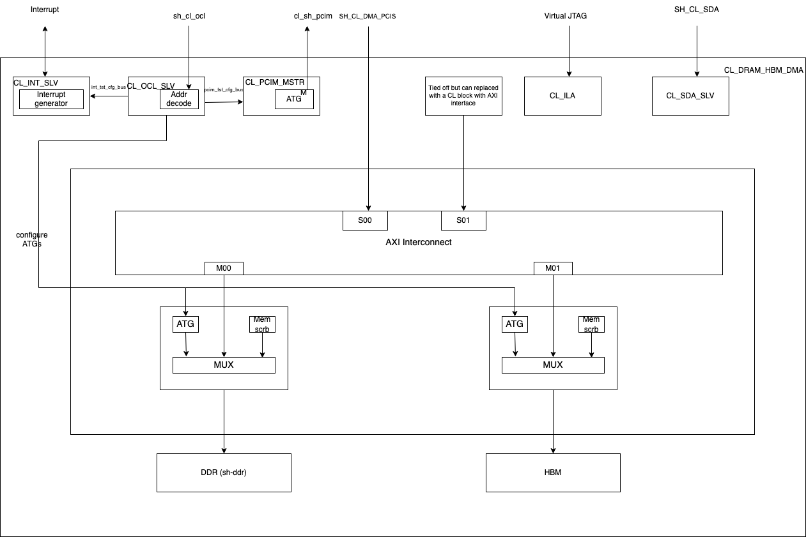

# CL_DRAM_HBM_DMA CustomLogic Example

## Table of Content

1. [Overview](#overview)
2. [Functional Description](#functional-description)
3. [Software](#software)
4. [Metadata](#metadata)

## Overview

The CL_DRAM_HBM_DMA example demonstrates the use and connectivity for many of the Shell/CL interfaces and functionality, including:

1) Register access over OCL AXI-Lite interface

2) Mapping of the external DRAM channel to instance memory via PCIe AppPF BAR4, and the 512-bit `sh_cl_dma_pcis_*` AXI4 bus

3) Mapping of HBM memory to instance memory via PCIe AppPF BAR4, and the 512-bit `sh_cl_dma_pcis_*` AXI4 bus

4) Debugging using Virtual JTAG and Xilinx Integrated Logic Analyzer (ILA) cores.

5) User-defined interrupts

6) `cl_sh_pcim_*` AXI4 traffic for host memory accesses from CL

### System diagram



## Functional Description

### Memory Interface

The cl_dram_hbm_dma demonstrates accessing 64GB of DDR memory and 16GB of single channel HBM memory over the `sh_cl_dma_pcis` AXI4 bus.

The CL provides access to the DDR memory through `sh_ddr.sv` which consists of the DDR controller required to interact with the external DDR DIMM on the FPGA card. The `sh_ddr.sv` is also connected to the Shell's `sh_cl_ddr_stat_*` ports to enable Shell to manage DDR calibration upon CL AFI loads.

The CL also provides access to the on-chip HBM available in the FPGA. The HBM IP is configured for dual stack 16GB capacity which exposes 32 AXI3 (not AXI4) channels running on 450MHz clock. However, only one HBM channel is being used in this example design to demonstrate datapath connection to the HBM. The [cl_hbm_axi4.sv](./design/cl_hbm_axi4.sv) does the AXI4-to-AXI3 conversion, crosses clock domain between the 250 MHz `clk_main_a0` and HBM's up to 450 MHz `axi_clk` for the datapath and feeds the `cl_hbm_wrapper.sv`. The [cl_hbm_wrapper.sv](./design/cl_hbm_wrapper.sv) instantiates the HBM IP, houses MMCM to generate 450MHz interface clock, and connects the datapath to Channel#0 of the HBM IP core.

**NOTE:** Since the CL utilizes only one HBM Channel which is fed by data source running at 250MHz clock, it does not accomplish the max available bandwidth from HBM. For demonstration of the max performance from HBM. refer to the [cl_mem_perf](../cl_mem_perf/README.md) example.

### Design Changes

Individual controllers (DDR, HBM) can be enabled and disabled by simply updating the appropriate defines in the [cl_dram_hbm_dma_defines.vh](./design/cl_dram_dma_defines.vh) file. The [sh_ddr.sv](../../../common/shell_stable/design/sh_ddr/sim/sh_ddr.sv) file contains the necessary logic to remove and tie-off appropriate interfaces when the DDR controller is disabled.

For the cl_dram_hbm_dma example memory ranges have been allocated for DDR and HBM. So, if a particular memory is disabled, then the developer should take care to handle transactions to that address range since there will be no controller to respond to the request. The address ranges for each controller is described below in the [dma_pcis AXI4 bus section](#dma_pcis-AXI4-bus).

### Test Changes

If a particular controller is disabled, make sure that the test is not accessing address space for that controller.

Please look at [dma_pcis AXI4 bus section](#dma_pcis-AXI4-bus) for address ranges.

If DDR is enabled, make sure that the DDRs are initialized using the poke_stat commands below.

eg:
To initialize DDR

```verilog
tb.poke_stat(.addr(8'h0c), .ddr_idx(0), .data(32'h0000_0000));
```

Make sure that the Host to Card and Card to Host DMA transfers only access enabled DDR controller address space.

### dma_pcis AXI4 bus

sh\_cl\_dma\_pcis exposes a address windows of 128GB matching AppPF BAR4.

This memory space is mapped to the 64GB DRAM space and 16GB HBM space.
An axi_crossbar interconnects the incoming address requests to the target memories as shown below:

* DDR base_addr=0x00_0000_0000 (range=64GB)
* HBM base_addr=0x10_0000_0000 (range=16GB)

**NOTE**: Please refer to [Supported DDR Modes](./../../../docs/Supported_DDR_Modes.md) for details on supported DDR configurations in `sh_ddr.sv`.

### ocl\_ AXI-Lite


The cl_ocl\_ AXI-Lite bus is connected to [cl_ocl_slv.sv](./design/cl_ocl_slv.sv) module, and is used for register access to the Automatic Test Generator (ATG) etc.


The valid address map is as shown below:

| Module     | OCL Start Address | OCL End Address | Description                                                                                      |
|------------|-------------------|-----------------|--------------------------------------------------------------------------------------------------|
| PCIM ATG   | 0x0000            | 0x00FF          | PCIM Traffic Generator (refer to cl_tst.sv)                                                      |
| DDR ATG    | 0x0100            | 0x01FF          | DDR Traffic Generator                                                                            |
| HBM ATG    | 0x0200            | 0x02FF          | HBM Traffic Generator                                                                            |
| HBM Status | 0x0300            | 0x0300          | bit[31:3] - Reserved (RO), bit[2:1] - HBM Initialized, bit[0] - SW Reset for HBM. (1 = Reset HBM) |

Any access to invalid address shall return 32'hdeadbeef

### sda\_ AXI-Lite

The sh_cl_sda\_ AXI-Lite bus is connected to [cl_sda_slv.sv](./design/cl_sda_slv.sv) module, which provides 1KiB of scratch RAM.

Address bits [9:0] will be used to access the location of the RAM, but the upper bits of the address are ignored.

### pcim\_ AXI4

The cl_sh_pcim\_  AXI4 bus is driven by Automatic Test Generator (ATG) and connected to [cl_pcim_mstr.sv](./design/cl_pcim_mstr.sv). It can be used to read/write from the host memory.

### irq/ack

[cl_int_slv.sv](./design/cl_int_slv.sv) provides an example for generating the IRQ requests and checks if ACK has been received.

### Virtual JTAG

This design contains three integrated ILA cores. One to monitor the sh\_c_dma\_pcis bus, one to monitor the AXI4 signals on DDR, both in [cl_ila.sv](./design/cl_ila.sv), and one to monitor the VIO counter signals in [cl_vio.sv](./design/cl_vio.sv).

### Clocks

CL_DRAM_HBM_DMA uses the main `clk_main_a0`. It's frequency is set in [cl_timing_user.xdc](./build/constraints/cl_timing_user.xdc)

### Software

DMA accesses rely on the [XDMA driver](../../../docs/XDMA_Install.md)

The DRAM_HBM DMA example includes runtime software to demonstrate working DMA accesses. The runtime example is located [in the runtime directory](./software/runtime/test_dram_hbm_dma.c)

#### test_dram_hbm_dma.c

This test has four legs and prints `TEST PASSED` or `TEST FAILED` at the end.

1. DMA and bandwidth. The test uses one XDMA channel and runs DMA operations sequentially on a single thread. It writes DDR then HBM, and reads DDR then HBM, each as one contiguous range. Transfers use 256 MiB chunks, chosen for their high throughput; achieved rates depend on the host, driver, and memory path. For each transfer the XDMA driver allocates a 512 KiB contiguous page list, so on a host with fragmented memory a transfer can fail with ENOMEM. The error message then suggests lowering `CHUNK_SIZE` in `test_dram_hbm_dma.c` or compacting host memory. DDR write, HBM write, DDR read, and HBM read each report GiB transferred, elapsed time, and GiB/s. Initial buffer preparation and the verification in leg 2 are excluded from timing. These host-observed rates include driver overhead and per-chunk address stamping on writes. Bandwidth numbers do not decide pass or fail; a DMA error does.
2. Verification. Right after each chunk is read, it is compared against the random pattern and its address stamp. Verification is untimed. The first differing byte fails the test; the log names the chunk address and the first differing byte.
3. AXI master. One register-driven write and read to DDR and to HBM.
4. Interrupts. All 16 user interrupts are triggered and observed.

The test covers all 80 GiB of device memory: 64 GiB of DDR followed by 16 GiB of HBM, which form one contiguous address range.

### Compile and run instructions

```bash
cd ${CL_DIR}/software/runtime
make all
sudo ./test_dram_hbm_dma
```

## Metadata

Use the following values to register this CL as an AFI. To skip the build, load the pre-built public AFI below instead.

| Key | Value |
|-----|-------|
| PCI Device ID | 0xF001 |
| PCI Vendor ID | 0x1D0F (Amazon) |
| PCI Subsystem ID | 0x1D51 |
| PCI Subsystem Vendor ID | 0xFEDC |

### Pre-built AFI

| Shell | Shell Version | AGFI ID |
|-------|---------------|---------|
| XDMA Shell | 0x10052623 | agfi-09d63a981b83fa3ea |

This AFI is public in us-east-1 only. Launch your F2 instance in us-east-1 and load it with `sudo fpga-load-local-image -S 0 -I agfi-09d63a981b83fa3ea`. This AFI uses the XDMA Shell, so install the [XDMA driver](../../../docs/XDMA_Install.md) to use its DMA engine.
