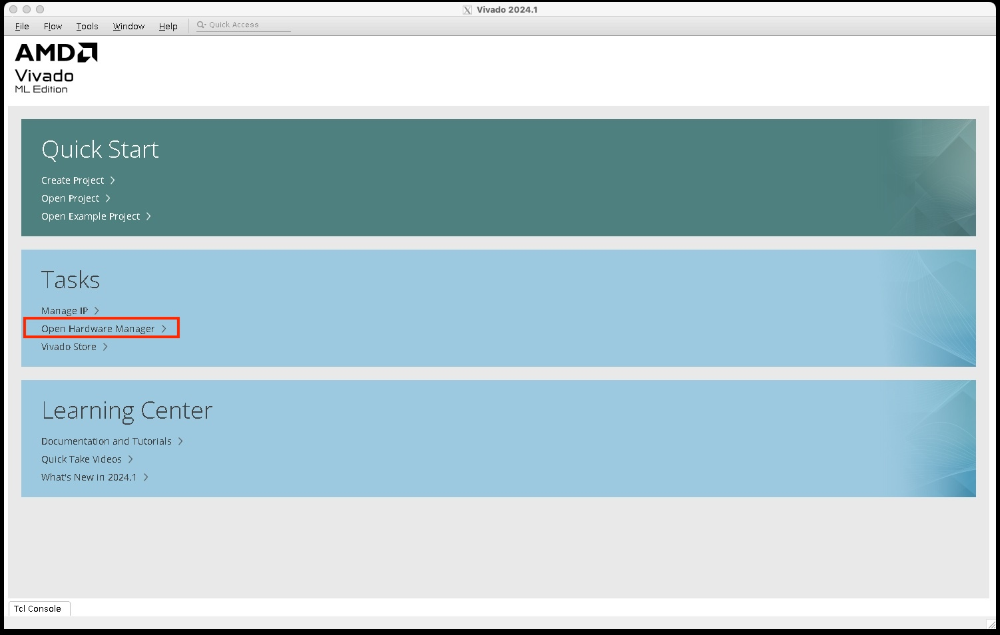
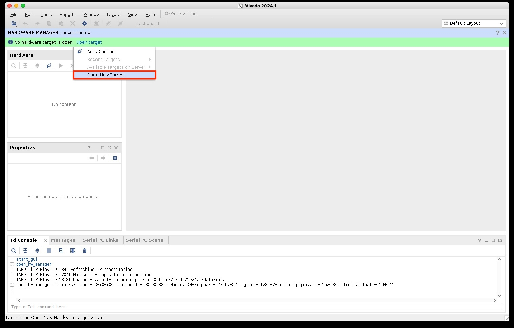
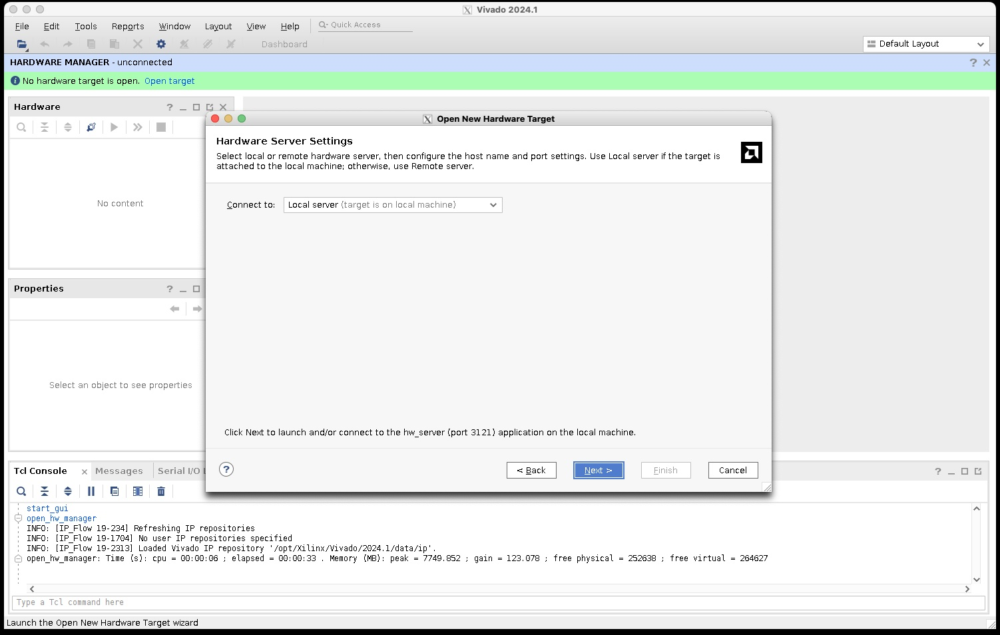
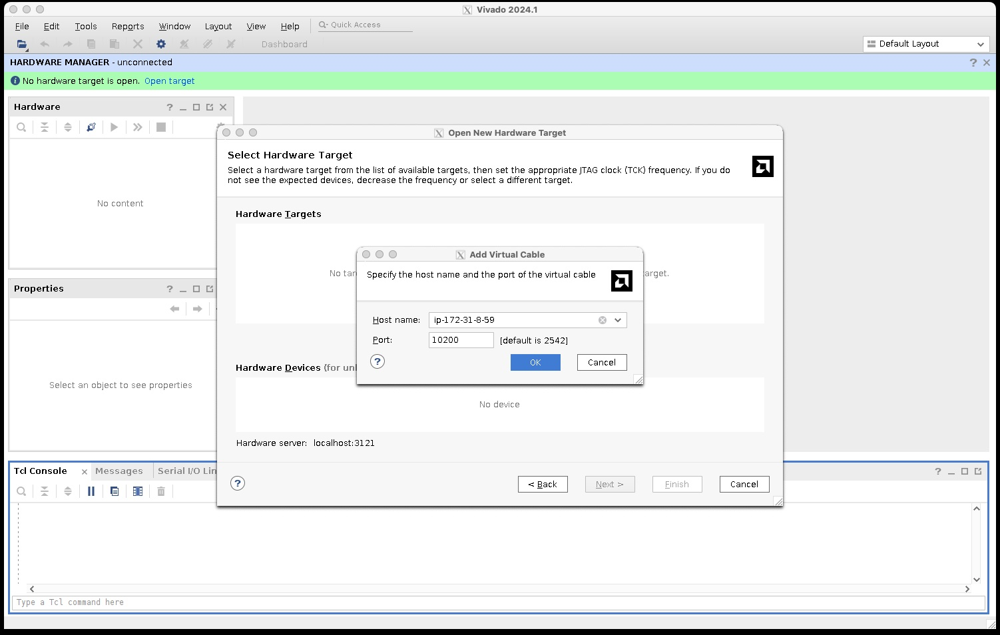
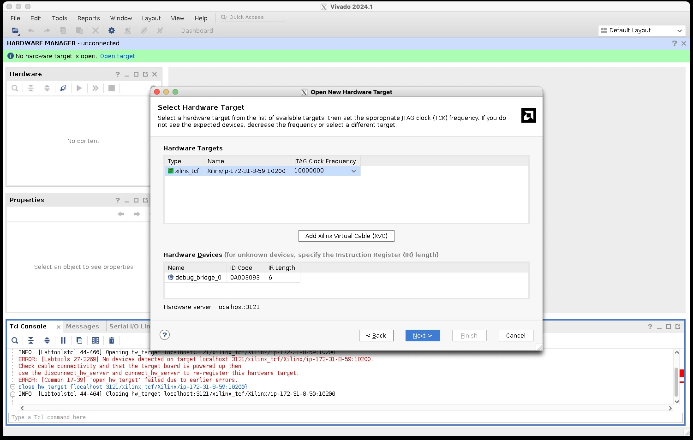
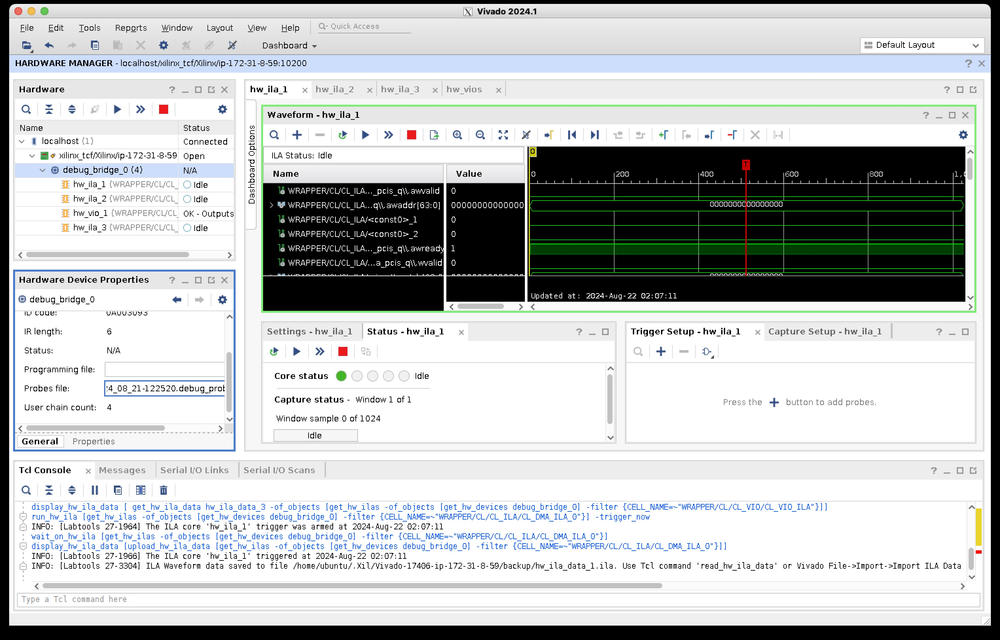

# Virtual JTAG for Real-time FPGA Debug

## Table of Contents

- [Virtual JTAG for Real-time FPGA Debug](#virtual-jtag-for-real-time-fpga-debug)
  - [Table of Contents](#table-of-contents)
  - [Overview](#overview)
  - [Install XVC Driver on F2 Instances](#install-xvc-driver-on-f2-instances)
  - [Start Local Debug Server on F2 Instances](#start-local-debug-server-on-f2-instances)
  - [Connect to target FPGA via Virtual JTAG](#connect-to-target-fpga-via-virtual-jtag)
  - [Embedded Debug Bridge in CL](#embedded-debug-bridge-in-cl)
  - [Frequently Asked Questions](#frequently-asked-questions)

## Overview

Amazon EC2 F2 instances offer debugging capabilities through Virtual JTAG. This feature leverages the Xilinx Virtual Cable (XVC) protocol to emulate JTAG cable connectivity to a target FPGA over the PCIe interface. Developers can connect to Xilinx debug cores, such as the [Integrated Logic Analyzer (ILA)](https://www.xilinx.com/products/intellectual-property/ila.html) and [Virtual Input/Output (VIO)](https://www.xilinx.com/products/intellectual-property/vio.html) in Custom Logic (CL) designs within Vivado, to monitor, control, and debug their designs.

The Virtual JTAG solution consists of three main elements:

- [A] Debug cores and a debug bridge that must be implemented and connected properly in the CL design. Refer to the [cl_dram_hbm_dma](../cl/examples/cl_dram_hbm_dma/README.md) example design for details.
- [B] A Virtual-JTAG service acting as an XVC server that runs on the target F2 instance.
- [C] A local or remote Vivado application for interactive debugging.

## Install XVC Driver on F2 Instances

To begin debugging a CL design, the developer must first install the XVC driver (skip this step if the driver is pre-installed). This section provides a guide for installing the XVC driver on F2 instances using the AWS FPGA developer AMI. For detailed compilation and installation information, refer to the [AMD product guide](https://docs.amd.com/r/en-US/pg195-pcie-dma/Compiling-and-Loading-the-Driver).

[install_xilinx_virtual_cable.sh](./../../developer_resources/runtime_ami_builder/scripts/install_xilinx_virtual_cable.sh) from the [Runtime AMI Builder](./../../developer_resources/runtime_ami_builder/README.md) performs all of the steps in this section. It then runs the XVC loopback test on every FPGA in the instance and prints `XVC loopback test passed on <N> FPGA(s)!` when the driver works:

```bash
# FPGA Developer AMI, or any AMI where Vivado's environment is set up (uses $XILINX_VIVADO)
$AWS_FPGA_REPO_DIR/developer_resources/runtime_ami_builder/scripts/install_xilinx_virtual_cable.sh
# Runtime AMI with Vivado Lab Edition 2025.1 or 2025.2 installed by the Runtime AMI Builder
$AWS_FPGA_REPO_DIR/developer_resources/runtime_ami_builder/scripts/install_xilinx_virtual_cable.sh -v 2025.2
# Any other Vivado or Vivado Lab Edition install
$AWS_FPGA_REPO_DIR/developer_resources/runtime_ami_builder/scripts/install_xilinx_virtual_cable.sh -p /opt/Xilinx/2025.2/Vivado
```

To install the driver manually instead, follow the steps below.

- Building the driver requires `gcc`, `make`, and the kernel headers for the running kernel. Install them if they are not already present:

``` bash
    # Ubuntu
    sudo apt-get install -y gcc make build-essential linux-headers-$(uname -r)
    # Rocky Linux
    sudo dnf install -y gcc make kernel-devel-$(uname -r)
```

- Locate and unzip the XVC driver file from the Vivado tool installation directory. Set `VIVADO_DIR` to the Vivado installation on your AMI. On the FPGA Developer AMI, Vivado's environment is already set up, so use `$XILINX_VIVADO`. `$XILINX_VIVADO` is not set on a runtime AMI with only Vivado Lab Edition, so set the path directly. The installation directory depends on the Vivado version and edition, for example:
  - Vivado 2025.1 and 2025.2: `/opt/Xilinx/<version>/Vivado`, for example `/opt/Xilinx/2025.2/Vivado`
  - Vivado 2024.1 and 2024.2: `/opt/Xilinx/Vivado/<version>`, for example `/opt/Xilinx/Vivado/2024.2`
  - Vivado Lab Edition installed by the Runtime AMI Builder: `/opt/Xilinx/<version>/Vivado_Lab`, for example `/opt/Xilinx/2025.2/Vivado_Lab`

``` bash
    # FPGA Developer AMI (Vivado environment already set up)
    export VIVADO_DIR=$XILINX_VIVADO
    # Runtime AMI with Vivado Lab Edition, for example:
    # export VIVADO_DIR=/opt/Xilinx/2025.2/Vivado_Lab
    unzip $VIVADO_DIR/data/xicom/drivers/pcie/xvc_pcie.zip
    cd driver_v0.4
```

- To correctly bind the XVC driver to the FPGA, update the `PCIE_VENDOR_ID` and `PCIE_DEVICE_ID` in `xvc_pcie_user_config.h` file:

``` bash
    vim xvc_pcie_user_config.h

    ...
    #define PCIE_VENDOR_ID  0x1D0F // Update to use PF1 for Virtual JTAG
    #define PCIE_DEVICE_ID  0x9248 // Update to use PF1 for Virtual JTAG

    ...
    {
        .name = "",
        .config_space   = AUTO,
        .config_info = {
            .config_vsec_id  = 0x0008,
            .config_vsec_rev = 0x0,
        },
        .bar_info = {
            .bar_index      = 0x2,    // Update to bind to BAR2
            .bar_offset     = 0x0000, // Update to bind to offset 0
        },
    },
```

  ⚠️ On Ubuntu 24.04, and other systems with Linux kernel 6.4 or later, the driver fails to compile with this error:

```bash
/home/ubuntu/driver_v0.4/xvc_pcie_driver_base.c:306:25: error: too many arguments to function ‘class_create’
  306 |         xvc_dev_class = class_create(THIS_MODULE, "xil_xvc_class");
```

- To resolve the error, remove the `THIS_MODULE` argument from `class_create` in the `xvc_pcie_driver_base.c` file. Only make this change on kernel 6.4 or later, such as Ubuntu 24.04. Rocky Linux 8.10 uses an older kernel and needs the original code.

```C
    305 // Register the character device class for the actual files
    306    xvc_dev_class = class_create("xil_xvc_class"); // Remove THIS_MODULE here
    307    if (IS_ERR(xvc_dev_class)) {
    308            xil_xvc_cleanup();
    309            return PTR_ERR(xvc_dev_class);
    310    }
```

  The same change can be made with this command:

```bash
    sed -i '/class_create/ s/class_create(THIS_MODULE,/class_create(/' xvc_pcie_driver_base.c
```

- Next, compile and install the XVC driver:

``` bash
    sudo make install
    sudo depmod -a
    sudo modprobe xilinx_xvc_pci_driver
    lsmod | grep xilinx
    ...
    xilinx_xvc_pci_driver    20480  0 ---> This means XVC driver is successfully installed
```

  When reinstalling the driver, unload the running driver with `sudo modprobe -r xilinx_xvc_pci_driver` before loading the new one.

## Start Local Debug Server on F2 Instances

- To start the XVC server on a instance, run the `xvc_pcie` executable in Vivado installation directory. The application should spit out the host server name and port number. These information will later be used to create a virtual JTAG cable in Vivado Hardware Manager. The commands below use `VIVADO_DIR` from the [install section](#install-xvc-driver-on-f2-instances). In a new shell, set it again first.

``` bash
    cd $VIVADO_DIR/bin
    sudo ./xvc_pcie

    Description:
    Xilinx xvc_pcie v2024.2  -- Version will depend on your devAMI --
    Build date : May 22 2024-19:19:01
    Copyright 1986-2018 Xilinx, Inc. All Rights Reserved.

    INFO: XVC PCIe Driver character file - /dev/xil_xvc/cfg_ioc0
    INFO: XVC PCIe Driver configured to communicate with Debug Bridge IP in AXI mode (PCIe BAR space).
    INFO: PCIe BAR index=0x0002 and PCIe BAR offset=0x0000
    INFO: XVC PCIE Driver Loopback test successful.

    INFO: xvc_pcie application started
    INFO: Use Ctrl-C to exit xvc_pcie application

    INFO: To connect to this xvc_pcie instance use url: tcp:ip-172-31-8-59:10200 ---> This shows the host server name and the port number
```

- `XVC PCIE Driver Loopback test successful.` confirms the XVC driver is installed and working for that FPGA. `xvc_pcie` keeps running until it's stopped with Ctrl-C.
- By default, `xvc_pcie` connects to the first FPGA (`/dev/xil_xvc/cfg_ioc0`) on port 10200. Instances with more than one FPGA have one driver character file per FPGA, `cfg_ioc0` through `cfg_ioc7` on an f2.48xlarge. To debug another FPGA, select its file with `-d` and give each `xvc_pcie` its own port with `-s`:

``` bash
    sudo ./xvc_pcie -d /dev/xil_xvc/cfg_ioc1 -s TCP::10201
```

## Connect to target FPGA via Virtual JTAG

With a XVC server up and running, a Virtual JTAG cable connection to the target FPGA is ready to be built in Vivado.

- Prior to executing Vivado, verify that the `.LTX` probe file from the CL design DCP tarball is saved on the instance.

```bash
    $ tar -tvf 2024_08_21-122520.Developer_CL.tar

    drwxr-sr-x 0 2024-08-21 13:15 to_aws/
    -rw-r--r-- 91676787 2024-08-21 13:15 to_aws/2024_08_21-122520.SH_CL_routed.dcp
    -rw-r--r--   655601 2024-08-21 13:15 to_aws/2024_08_21-122520.debug_probes.ltx ---> This is the probe file
    -rw-r--r--      398 2024-08-21 13:54 to_aws/2024_08_21-122520.manifest.txt
```

- Open Vivado GUI and select "Open Hardware Manager"



- Click "Open target" and select the "Open New Target...".



- For hardware server setting, connect to "Local server" and click "Next"



- Click "Add Xilinx Virtual Cable (XVC)" and put in "Host name" and "Port" collected previously from the XVC server. Click "OK" to proceed.



- The debug bridge in the target design should be detected and listed in "Hardware Targets". Click "Next" and "Finish" to finish setting up the Virtual JTAG connection.



- All the debug cores embedded in the CL design should be now listed under `debug_bridge_0`. Highlight `debug_bridge_0` and add the CL design `.LTX` probe file to "Probes file" in the "Hardware Device Properties" window. After the probe file gets loaded, the waveform and configuration windows will be available for each debug core in Vivado. The CL design at this point is ready to be debugged.



## Embedded Debug Bridge in CL

The [CL_Debug_Bridge](https://github.com/aws/aws-fpga-resources/blob/-/cl_ip/cl_ip.srcs/sources_1/ip/cl_debug_bridge/cl_debug_bridge.xci) IP must be embedded in the CL design to enable the use of debug cores like ILA and VIO. According to the [AMD user guide](https://docs.amd.com/r/en-US/ug908-vivado-programming-debugging/Debug-Cores-Clocking-Guidelines), the clock of `CL_Debug_Bridge` must be at least 2.5 times faster than the JTAG clock. The JTAG clock frequency is fixed at 31.25 MHz in the F2 shells. Therefore, the frequency of the clock connected to the `CL_Debug_Bridge` should be at least 2.5 x 31.25 MHz = 78.125 MHz. Failure to meet this requirement will result in the debug network not functioning correctly. However, this minimum clock frequency requirement does not apply to the ILA or VIO debug cores or the rest of the CL logic. If the CL design is running on a slower clock from the available clock recipes, care must be taken to ensure that the `CL_Debug_Bridge` is clocked at 78.125 MHz or above.

```verilog
    //-----------------------------------
    // Debug bridge
    //-----------------------------------
    cl_debug_bridge CL_DEBUG_BRIDGE
    (
      .clk                  (aclk       ),
      .S_BSCAN_drck         (drck       ),
      .S_BSCAN_shift        (shift      ),
      .S_BSCAN_tdi          (tdi        ),
      .S_BSCAN_update       (update     ),
      .S_BSCAN_sel          (sel        ),
      .S_BSCAN_tdo          (tdo        ),
      .S_BSCAN_tms          (tms        ),
      .S_BSCAN_tck          (tck        ),
      .S_BSCAN_runtest      (runtest    ),
      .S_BSCAN_reset        (reset      ),
      .S_BSCAN_capture      (capture    ),
      .S_BSCAN_bscanid_en   (bscanid_en )
    );
```

All debug cores within the CL must be connected to the `CL_Debug_Bridge`. These connections can be automatically inserted during the design synthesis process. For an example implementation, please refer to the [synth_cl_dram_hbm_dma.tcl script](./../cl/examples/cl_dram_hbm_dma/build/scripts/synth_cl_dram_hbm_dma.tcl) in the cl_dram_hbm_dma example.

``` bash
AWS FPGA: (12:35:47): Connecting debug network

## set cl_ila_cells [get_cells [list CL_ILA/CL_DMA_ILA_0 CL_ILA/ddr_A_hookup.CL_DDRA_ILA_0]]
## if {$cl_ila_cells != ""} {
##   connect_debug_cores -master [get_cells [get_debug_cores -filter {NAME=~*CL_DEBUG_BRIDGE*}]] \
##                       -slaves $cl_ila_cells
## }

INFO: [Constraints 18-11670] Building netlist checker database with flags, 0x8
Done building netlist checker database: Time (s): cpu = 00:00:00.12 ; elapsed = 00:00:00.13 . Memory (MB): peak = 7233.012 ; gain = 0.000 ; free physical = 1006692 ; free virtual = 1545285
INFO: [Chipscope 16-344] Connected debug slave core CL_ILA/CL_DMA_ILA_0 to master core CL_ILA/CL_DEBUG_BRIDGE/inst/xsdbm
INFO: [Chipscope 16-344] Connected debug slave core CL_ILA/ddr_A_hookup.CL_DDRA_ILA_0 to master core CL_ILA/CL_DEBUG_BRIDGE/inst/xsdbm
connect_debug_cores: Time (s): cpu = 00:00:07 ; elapsed = 00:00:07 . Memory (MB): peak = 7233.012 ; gain = 0.000 ; free physical = 1006693 ; free virtual = 1545287
```

## Frequently Asked Questions

**Q: Do I need full Vivado installation to run Virtual JTAG debug on a F2 instance?**

A: No. If you are utilizing the AWS FPGA developer AMI, you can leverage the built-in Vivado. If you using a different runtime AMI, you can download the standalone Vivado Lab Solutions from [AMD website](https://www.xilinx.com/support/download/index.html/content/xilinx/en/downloadNav/vivado-design-tools.html) and use that for free. Choose a version listed in [supported_vivado_versions.txt](./../../supported_vivado_versions.txt). The [Runtime AMI Builder](./../../developer_resources/runtime_ami_builder/README.md) can install Vivado Lab Edition and the XVC driver on a runtime AMI.

**Q: Do I need a Vivado license to use Virtual JTAG and Xilinx VIO/ILA debug capabilities?**

A: No. All you require is the Vivado Hardware Manager, which is included with the Vivado Lab Solutions and is available free of charge.
