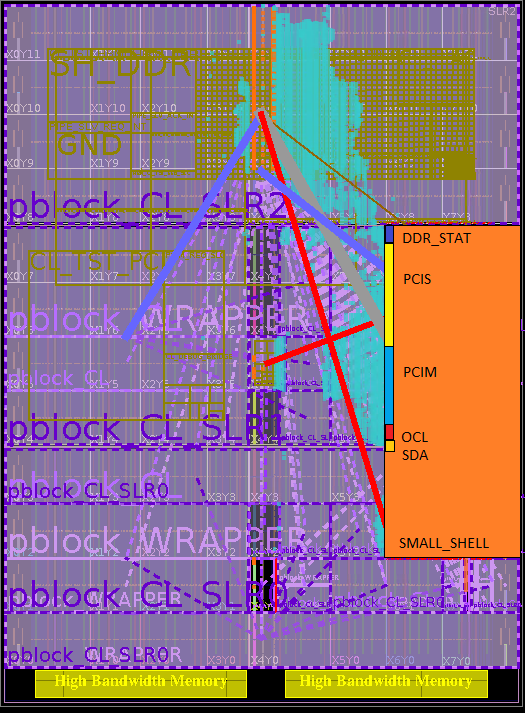
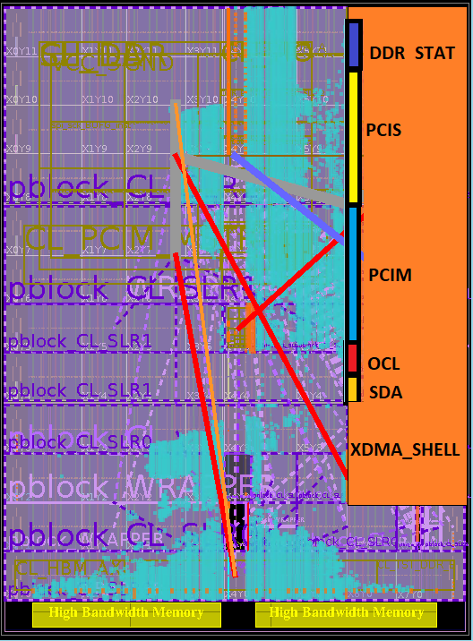

# Shell Floorplan Reference

This document provides the floorplans of the Small and XDMA Shells.

## Small Shell

## XDMA Shell

## Recommendations

* The PCIS bus is physically located in SLR1 in SMALL_SHELL. Any customer logic interfacing with this bus should reside in SLR1.
* The PCIS bus is physically located in SLR2 in the XDMA_SHELL. Any customer logic interfacing with this bus should reside in SLR2.
